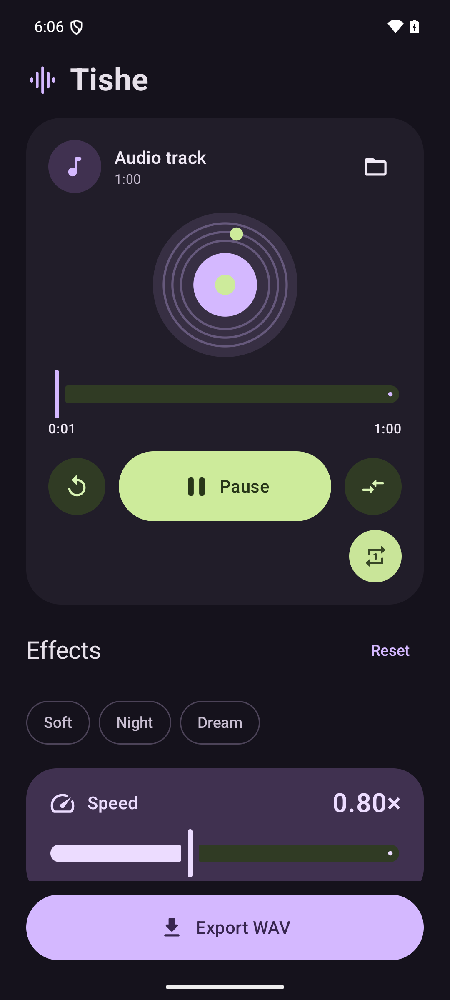
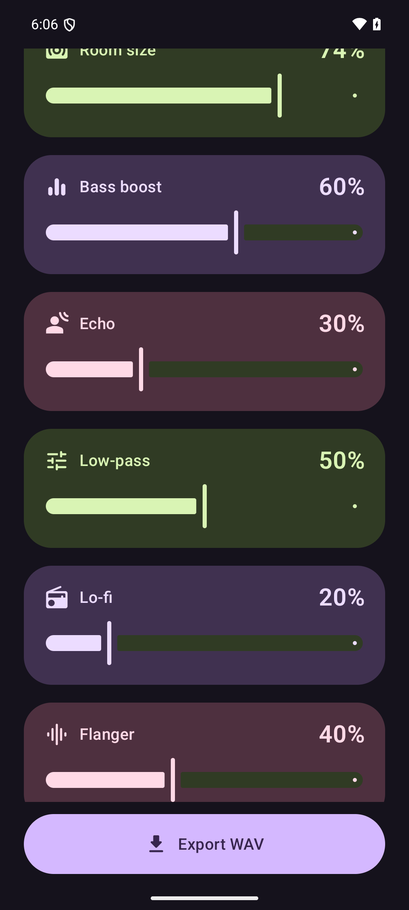

# Tishe

An Android **slowed + reverb** editor with live preview, built with Kotlin,
official Material 3 Expressive components and SoLoud/Freeverb.

## Download

Get the APK from [GitHub Releases](https://github.com/sofutoandowettox/Tishe/releases).
The current build is a debug-signed preview for testing.

  
  

## Features

- Import MP3, WAV, FLAC, OGG Vorbis and Opus through the system file picker.
- Adjust speed (0.5–1.25×), reverb and room size during playback.
- Add Bass boost, Echo, Low-pass, Lo-fi and Flanger using the built-in SoLoud
  filters. Each has an amount slider and starts disabled. Reset/presets clear
  the extra effects; original comparison bypasses the whole processing chain.
- Pause, seek, compare with the original, or use Soft/Night/Dream presets.
- Toggle repeat-one beside the player. Repeat continues in the background;
  exporting always writes one pass of the track with the selected effects.
- Export stereo 44.1 kHz / 16-bit WAV with a three-second reverb tail.
- Continue playing when the screen closes or the app moves to the background.
  A media notification provides Pause/Stop controls; the platform media session
  supports headset controls and seeking.
- English UI with concise control labels. Original adaptive outline launcher
  artwork inspired by Lawnicons, including an Android 13+ monochrome layer.

Android 8.0+, arm64-v8a and x86_64. Input is limited to one hour and 512 MiB,
mono/stereo. The original file is never modified. Speed also changes pitch.
Original comparison affects preview only; export always uses the effect settings.

Opus is decoded locally by Android MediaExtractor/MediaCodec to a temporary
16-bit WAV. Other supported formats stream directly through SoLoud. Decoding
Opus takes additional import time and storage; it does not add lossy encoding.

Playback runs as a mediaPlayback foreground service with a media notification
and a bounded partial wake lock, renewed during long/repeated playback. It pauses on audio focus loss or headphone
disconnect. Closing the Activity does not stop the service. Explicitly stopping
the app in Android settings still stops playback. A new process starts a new
editing session; sessions are not stored in a database.

## Build

JDK 17+, Android SDK 36, NDK 28.2.13676358, CMake 3.22.1.
Open the folder in Android Studio, or set the SDK path in local.properties.
The Gradle wrapper and the used SoLoud source subset are included. The first
build needs network access for Android/Gradle dependencies.

    .\gradlew.bat :app:assembleDebug :app:lintDebug

APK: app/build/outputs/apk/debug/app-debug.apk (version 0.3.0).

## Tests

Select a test device with ANDROID_SERIAL, then run:

    .\gradlew.bat :app:connectedDebugAndroidTest

Synthetic instrumentation checks exercise the compiled native engine, Opus
decoding, the English editor, export, background playback after Activity
destruction, reopening the editor and notification Pause.
Additional native checks verify repeat wrap for every input format, finite
one-pass export, effect output changes, bass/low-pass frequency response and
effect range validation.

See [architecture](docs/ARCHITECTURE.md), [verification](docs/VERIFICATION.md),
and [vendor notes](third_party/soloud/README.md). Source and bundled asset files
contain third-party notices. Material 3 Expressive uses a pinned alpha version.

AAC/M4A import, MP3 export and persistent project storage are not included.
